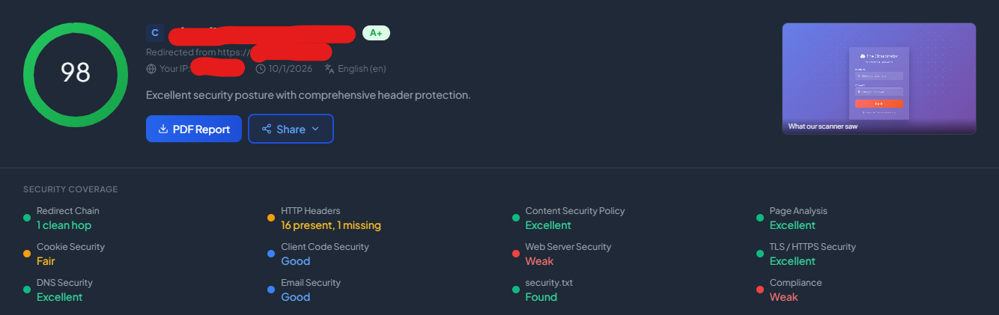
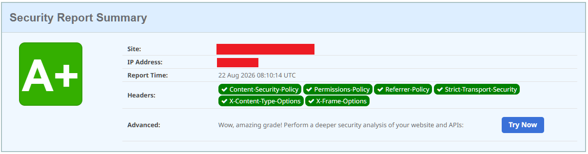
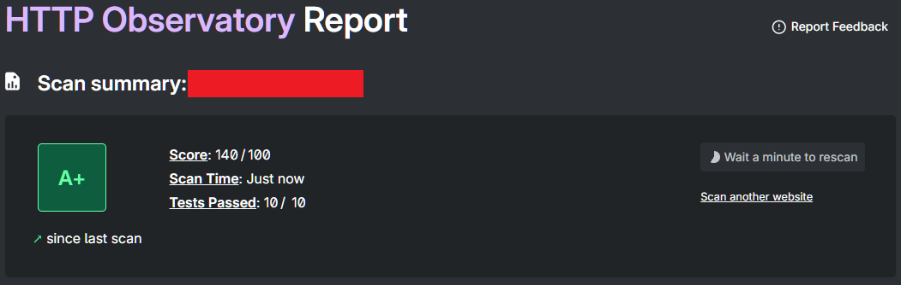
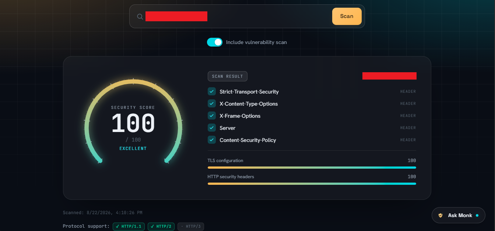
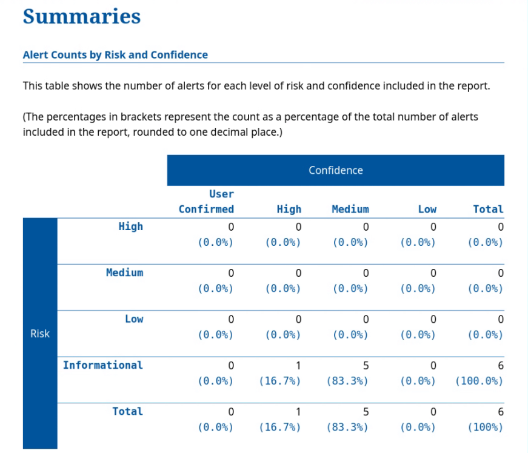
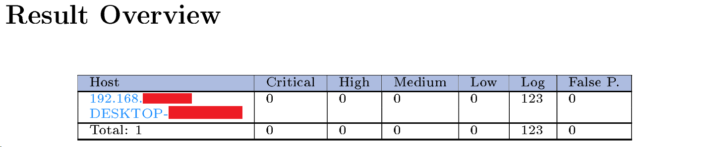
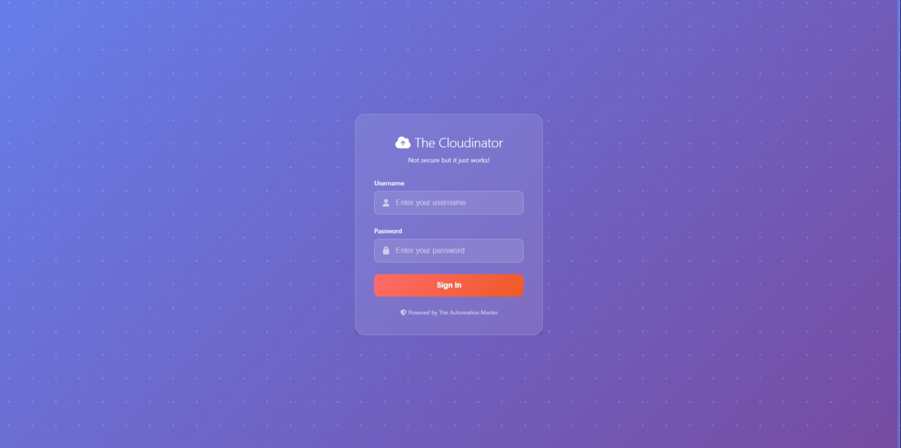
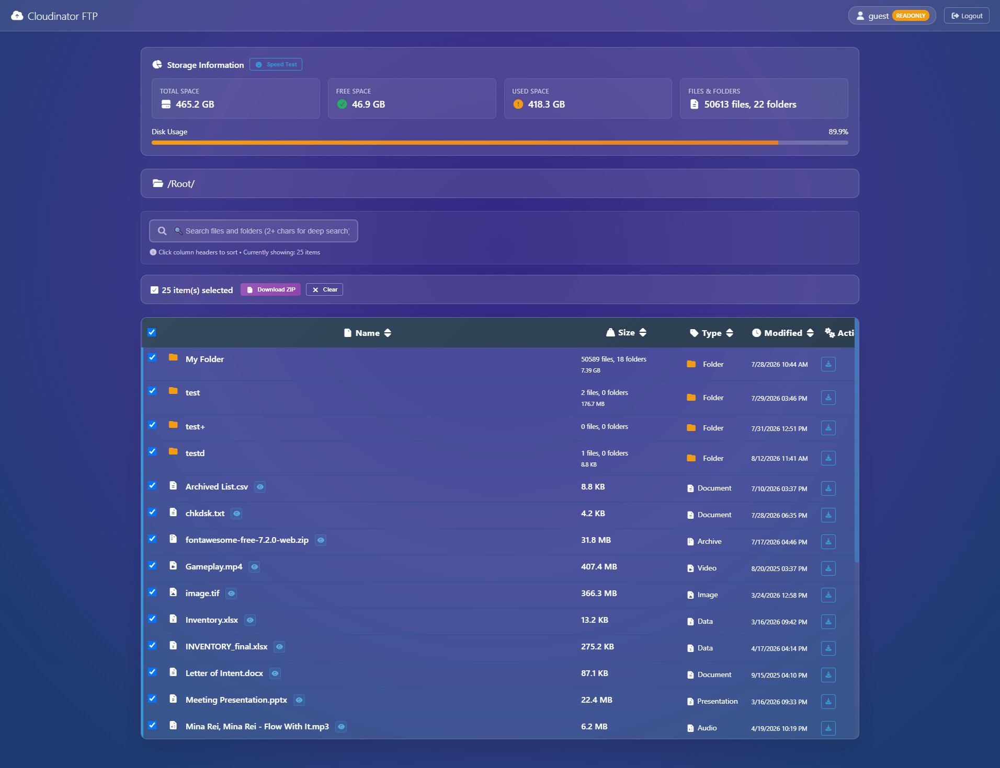
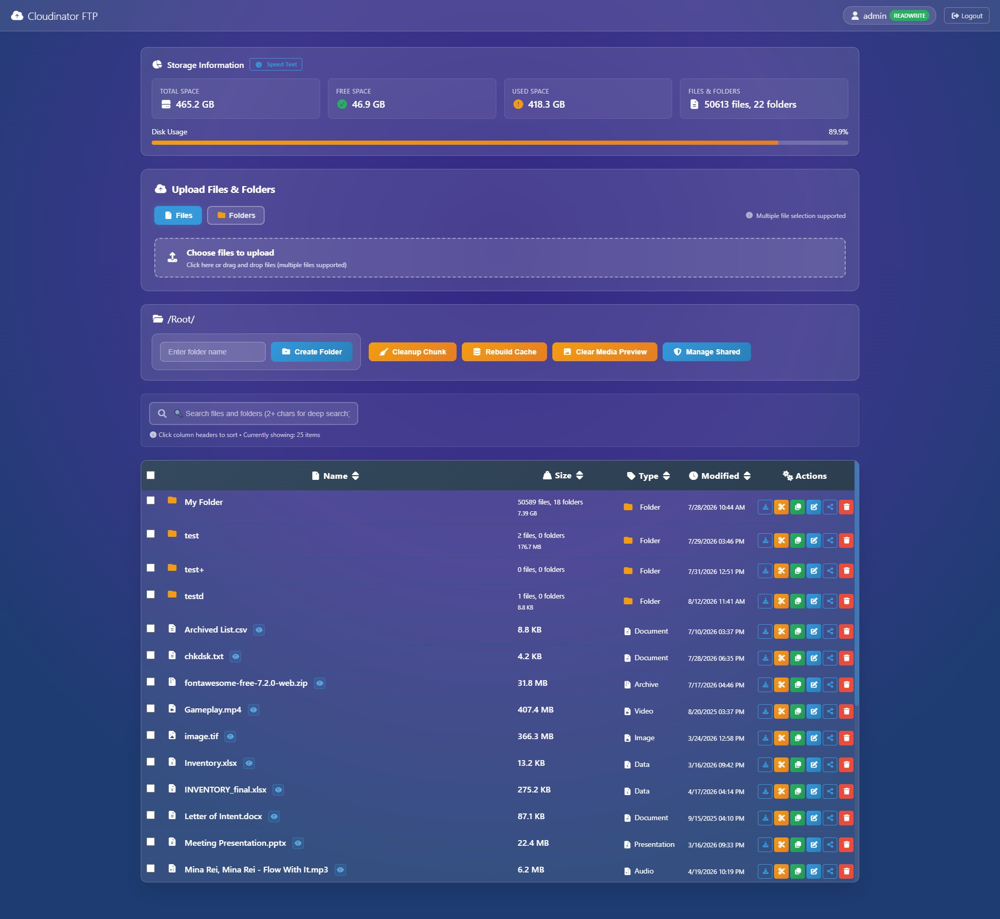

# 📁 Cloudinator - Cloudflare and Termux FTP

A lightweight FTP-like file transfer server that runs on **Termux (Android), Linux, and Windows** and exposes itself to the internet via Cloudflare tunnels. Access your device's storage from anywhere!


## 📷 Properly Configured Cloudflare Tunnel (Deployed on Windows 10 22H2 Build 19045)
Scanner: [SiteSecurityScore](https://sitesecurityscore.com)


Scanner: [SecurityHeaders](https://securityheaders.com/)


Scanner: [HTTP Observatory Report (Mozilla)](https://developer.mozilla.org/en-US/observatory)


Scanner: [SecureMonk](https://securemonk.io)


Scanner: [OWASP ZAP](https://www.zaproxy.org/) (Attack Strengty: Insane, Alert Thresold: Low)


Scanner: [OpenVAS](https://openvas.org/) (Scanner: OpenVAS Default, Scan Config: Full and fast) - Found vulnerabilities for SFTP/FTP/WebDAV


## 📷 Login


## 📷 Guest (READONLY)


## 📷 Admin (READWRITE)


## 📋 Table of Contents

- [📦 Dependencies / Tools](#-dependencies--tools)
- [🚀 Quick Start](#-quick-start)
- [🌐 Protocol Access — WebDAV, SFTP, FTP](#-protocol-access--webdav-sftp-ftp)
- [🖥️ Server Management Script (manage.sh)](#️-server-management-script-managesh)
- [🔄 Updating Python Dependencies](#-updating-python-dependencies)
- [📂 Storage Configuration Guide](#-storage-configuration-guide)
- [👥 User Management Guide](#-user-management-guide)
- [🛠️ Troubleshooting](#️-troubleshooting)
- [🌐 Network & Server Configuration](#-network--server-configuration)
- [🤝 Contributing](#-contributing)
- [📄 License](#-license)

## 🚀 Deployment Guides

Platform-specific deployment and production guides are available in the **[`docs/`](./docs)** folder:

| Platform | Guide | Purpose |
|----------|-------|---------|
| 🪟 **Windows** | [WINDOWS_DEPLOYMENT.md](./docs/WINDOWS_DEPLOYMENT.md) | Step-by-step setup for Windows systems |
| 🐧 **Linux** | [LINUX_DEPLOYMENT.md](./docs/LINUX_DEPLOYMENT.md) | Installation and systemd service setup |
| 📱 **Android (Termux)** | [ANDROID_DEPLOYMENT.md](./docs/ANDROID_DEPLOYMENT.md) | Android/Termux deployment and optimization |
| 🪟 **Apache/WSGI** | [DEPLOY_APACHE.md](./docs/DEPLOY_APACHE.md) | Production Apache deployment with mod_wsgi |
| 🔗 **Cloudflare Tunnel** | [SETUP_TUNNEL_ADVANCED.md](./docs/SETUP_TUNNEL_ADVANCED.md) | Advanced tunnel setup with custom domains |
| 🔄 **rclone** | [RCLONE_DEPLOYMENT.md](./docs/RCLONE_DEPLOYMENT.md) | Mount and sync via rclone |
| 📡 **SMB** | [SMB_PROTOCOL_DEPLOYMENT.md](./docs/SMB_PROTOCOL_DEPLOYMENT.md) | One-time SMB setup per platform, antivirus quirk, connecting to the share |
| 📖 **User Guide** | [USER_GUIDE.md](./docs/USER_GUIDE.md) | End-user guide to the web file manager, including share links |
| 🖥️ **manage.sh** | [MANAGE_SCRIPT_GUIDE.md](./docs/MANAGE_SCRIPT_GUIDE.md) | Every `manage.sh` command, the interactive menu, logs, and troubleshooting on Windows, Linux and Termux |
| ⚙️ **Configuration** | [CONFIG_PY_REFERENCE.md](./docs/CONFIG_PY_REFERENCE.md) | Every `config.py` setting, defaults, the admin menu, and `server_config.json` |

---

## 📦 Dependencies / Tools

- 📱 [Termux](https://termux.dev/en/) - [F-Droid](https://f-droid.org/packages/com.termux/) or [GitHub](https://github.com/termux/termux-app)
- 🎨 [Font Awesome](https://fontawesome.com/) - Free v7.2.0
- 🎬 [FFmpeg](https://www.ffmpeg.org/) - Essentials v57 build 2026-03-19
- 📺 [Video.js](https://videojs.org/) - v10
- 📄 [PDF.js](https://mozilla.github.io/pdf.js/) - v3.11.174
- 🖼️ [libvips](https://www.libvips.org/) - v8.18.1
- 🔧 [Git](https://git-scm.com/) - Latest Version/Build
- 🟢 [Node.js](https://nodejs.org/en) - v24.22.0 LTS

## 🚀 Quick Start

### Prerequisites

- **Android**: Termux installed (**NOT** the Play Store version)
- **Linux**: Python 3.14.3+, pip, git, libvips, ffmpeg (optional)
- **Windows**: Python 3.14.3+, pip, git, libvips, FFmpeg (optional)
- Internet connection

### Installation & Setup

#### 1. 🔧 Initial Termux Setup

Install termux packages
``` Bash
pkg update -y && pkg upgrade -y && pkg install curl -y

# For main branch (stable):
curl -sL https://tinyurl.com/CloudinatorFTP | bash

# For dev branch:
curl -sL https://tinyurl.com/CloudinatorFTP-dev | bash
```

> The above URL runs `termux_setup.sh` automatically. This script installs all required Termux packages, applies Android-specific PyPPMd patches, requests storage permission, and **retries up to 5 times** on failure. After cloning the repo you can also run it directly with `bash termux_setup.sh`.

Note: For compatible platforms, [FFmpeg](https://www.gyan.dev/ffmpeg/builds/) is optional for adaptive bitrate video preview with [Video.js](https://videojs.org/).

#### 2. 📥 Clone the Project

For **main** Branch (Stable)
```bash
git clone https://github.com/NeoMatrix14241/CloudinatorFTP.git
cd CloudinatorFTP
```

For **dev** branch
```bash
git clone -b dev https://github.com/NeoMatrix14241/CloudinatorFTP.git
cd CloudinatorFTP
```

#### 3. 🐍 Install Python Dependencies

```bash
python -m venv .venv                    # Create the python environment
source ./.venv/Scripts/activate         # Windows (Git Bash): use the created environment
source .venv/bin/activate               # Linux / macOS / Android (Termux): use this line instead
pip install -r requirements.txt         # Main requirements
pip install -r requirements-dev.txt     # Dev only (optional) - if you will modify the code and run the tests
```

> **Note**: the activation script must be **sourced** (`source ...`). Running `./.venv/Scripts/activate` on its own starts a subshell and activates nothing. Windows virtual environments keep their scripts in `.venv/Scripts`, Linux, macOS and Termux in `.venv/bin`. `bash setup_pymodules.sh` (or `./manage.sh update-modules`) creates and activates `.venv` for you when you answer `y`.

#### 3b. 📡 Install Protocol Server Dependencies (Optional - but included in requirements.txt)

To enable WebDAV, SFTP, and FTP protocol access alongside the web UI:

```bash
pip install wsgidav paramiko pyftpdlib
```

| Package | Enables |
|---------|---------|
| `wsgidav` | WebDAV (HTTP on port 8080, HTTPS on port 8443 by default) |
| `paramiko` | SFTP (port 2222) |
| `pyftpdlib` | FTP (port 2121) |

> **Note**: These are optional. If any are missing, only that protocol server is skipped on startup. The web UI always starts regardless.

#### 4. 📂 Configure Server, Storage Location, and security.txt

**Storage & Cache**
```bash
python tools/setup_storage.py
```

**Server, Storage, & Cache (Advanced)**
```bash
python config.py
```
Every setting is explained in the [Configuration Reference](./docs/CONFIG_PY_REFERENCE.md).

**Update security.txt and robots.txt(Important for tunneling else optional up to you)**
```
# use your own details
# you can also use "bash manage.sh menu > 18 to create security.txt
# or run:
# bash manage.sh security-txt --contact you@example.com --expires 2030-09-03 --preferred-lang en,fil --canonical https://yourdomain.com/.well-known/security.txt
static\.well-known\security.txt

# by default, everything is blocked politely
static\robots.txt
```

#### 5. 👥 Setup Users (Optional)

**Default Users** (created automatically):
- Username: `admin`, Password: `admin123` (readwrite access)
- Username: `guest`, Password: `guest123` (readonly access)

**⚠️ Change default passwords immediately!**

**Add/Modify Users:**
```bash
python tools/manage_users.py
```

#### 6. 🎯 Launch the Server

> 💡 **Recommended for Windows/Linux:** Use [`manage.sh`](#️-server-management-script-managesh) to run servers in the background while keeping your terminal free for utilities.

For Hypercorn ASGI (Production/Live, HTTP/1.1, HTTP/2 and HTTP/3)
```bash
python prod_server.py # Hypercorn server (ASGI)
```

For the Quart development server (Development/Testing, HTTP/1.1)
```bash
python dev_server.py # Quart dev server (ASGI)
```

Protocol servers (WebDAV, SFTP, FTP) start **automatically** alongside the web server — no extra command needed.

#### 7. 🌍 Expose to Internet

Open a new terminal session and run — **choose what to tunnel**:

```bash
# Tunnel the web UI (most common)
cloudflared tunnel --url https://localhost:5000

# Or tunnel WebDAV (for remote network drive mapping)
cloudflared tunnel --url https://localhost:8443
```

You'll receive a public URL like: `https://random-words-12345.trycloudflare.com`

> **What port should I tunnel?**
> - `5000` → Web browser access (upload, download, preview via browser)
> - `8443` → WebDAV drive mapping from remote Windows/macOS/Linux machines (HTTPS, the default — use with `--url https://localhost:8443`)
> - `8080` → plain-HTTP WebDAV — **off by default**; it only listens if HTTPS is disabled (with `WEBDAV_ENABLED` on) or as the automatic fallback when the HTTPS certificate can't be prepared
> - Only one port can be tunneled at once with the quick `--url` method. For multiple services, see the [Advanced Tunnel Setup](./docs/SETUP_TUNNEL_ADVANCED.md).
>
> **Note**: SFTP (2222) and FTP (2121) are raw TCP — they work on your local network but cannot be exposed via standard Cloudflare Tunnel.

Or if you want to use it with domain, please refer to this [Advanced Cloudflared Tunneling Setup](https://github.com/NeoMatrix14241/CloudinatorFTP/wiki/Advanced-Cloudflare-Tunnelling-Setup) then use these configuration for config.yml of cloudflared:

```bash
tunnel: <tunnel id>
credentials-file: C:\Users\%username%\.cloudflared\<tunnel id>.json
protocol: quic
ingress:
  - hostname: yourowndomain.com
    service: https://localhost:5000
    originRequest:
      connectTimeout: 0s
      tlsTimeout: 0s
      tcpKeepAlive: 0s
      noTLSVerify: true
      disableChunkedEncoding: false
      keepAliveConnections: 100000000
      keepAliveTimeout: 0s
      proxyConnectTimeout: 0s
      expectContinueTimeout: 0s
  - hostname: files.yourowndomain.com
    service: https://localhost:8443
    originRequest:
      connectTimeout: 0s
      tlsTimeout: 0s
      tcpKeepAlive: 0s
      noTLSVerify: true
      disableChunkedEncoding: false
      keepAliveConnections: 100000000
      keepAliveTimeout: 0s
      proxyConnectTimeout: 0s
      expectContinueTimeout: 0s
  - service: http_status:404
```

---

## 🌐 Protocol Access — WebDAV, SFTP, FTP

In addition to the web UI, CloudinatorFTP runs three additional protocol servers automatically. All use the **same credentials** as the web interface.

### Port Overview

| Service | Port | Best For |
|---------|------|----------|
| 🌐 Web UI | 5000 | Browser-based file management |
| 🔐 WebDAV HTTPS | 8443 | Native drive mapping (secure, on by default) |
| 📂 WebDAV HTTP | 8080 | Plaintext fallback — off by default (see the note under WebDAV below) |
| 🔒 SFTP | 2222 | WinSCP, FileZilla, sshfs |
| 📁 FTP | 2121 | Legacy FTP clients (LAN only) |

### 🌐 WebDAV — Map as a Network Drive

No browser needed — the server appears as a drive letter or volume in your file manager.

> The examples below use **HTTPS on port 8443**, which is what runs by default. Plain HTTP on port 8080 is off by default and only listens if HTTPS is disabled (with `WEBDAV_ENABLED` on) or as the automatic fallback when the HTTPS certificate can't be prepared.

**Windows (elevated PowerShell — first time only):**
```powershell
# 1. Get the certificate. Simplest and safest: copy db/webdav.crt from the server
#    to this PC yourself (USB, scp, shared folder...), then import it:
Import-Certificate -FilePath "C:\path\to\webdav.crt" -CertStoreLocation Cert:\LocalMachine\Root

# Alternative: download it from the server's HTTPS port. The cert isn't trusted yet,
# so the download has to skip verification (curl.exe is bundled with current Windows 10/11).
# This is trust-on-first-use - only do it on a network you trust.
curl.exe -k -o "$env:TEMP\webdav.crt" https://SERVER-IP:8443/webdav.crt
Import-Certificate -FilePath "$env:TEMP\webdav.crt" -CertStoreLocation Cert:\LocalMachine\Root

# Map HTTPS drive (no registry edit needed after cert import)
net use X: https://SERVER-IP:8443/ /user:admin admin123 /persistent:yes
```

**macOS:**  Finder → Go → Connect to Server → `https://SERVER-IP:8443/` (trust the certificate first: `sudo security add-trusted-cert -d -r trustRoot -k /Library/Keychains/System.keychain webdav.crt`)

**Linux:**
```bash
sudo apt install davfs2
sudo cp webdav.crt /usr/local/share/ca-certificates/cloudinator.crt
sudo update-ca-certificates
sudo mount -t davfs https://SERVER-IP:8443/ /mnt/cloudinator
```

### 🔒 SFTP — WinSCP Quick Setup

- **Protocol**: SFTP  
- **Host**: server IP  
- **Port**: `2222`  
- **Credentials**: same as web UI  
- Accept the host key warning on first connect

### 📁 FTP — WinSCP Quick Setup

- **Protocol**: FTP  
- **Encryption**: No encryption  
- **Host**: server IP  
- **Port**: `2121`  
- **Credentials**: same as web UI

> ⚠️ FTP is plaintext — use on trusted local networks only.

### 🔄 rclone

rclone can mount, sync, and copy via WebDAV, SFTP, or FTP. See [RCLONE_DEPLOYMENT.md](./docs/RCLONE_DEPLOYMENT.md) for full setup.

```bash
# Quick WebDAV mount (no configuration needed)
rclone mount :webdav,url=https://SERVER-IP:8443/,user=admin,pass=admin123,no_check_certificate=true: Z: --vfs-cache-mode full
```

---

## 🖥️ Server Management Script (`manage.sh`)

A shell script for **Windows (Git Bash), Linux and Android (Termux)** that runs a server in the background while keeping your terminal free to run utilities — no separate terminal window needed. Full reference: **[MANAGE_SCRIPT_GUIDE.md](./docs/MANAGE_SCRIPT_GUIDE.md)**.

### ⚡ Setup

```bash
chmod +x manage.sh
```

### 🚦 Server Commands

> ⚠️ Only one server can run at a time. Attempting to start a second will show a clear status block and stop.

| Command | Description |
|---------|-------------|
| `./manage.sh start server` | Start `prod_server.py` (Hypercorn) in the background |
| `./manage.sh start dev_server` | Start `dev_server.py` (Quart) in the background |
| `./manage.sh stop` | Gracefully stop whichever server is running |
| `./manage.sh restart` | Restart the currently active server |
| `./manage.sh restart-webdav` | Restart only WebDAV (recovers a stuck WebDAV without touching the web UI) |
| `./manage.sh status` | Show server status, PID, uptime, and recent log tail |

### 📋 Log Commands

Logs are always saved to `logs/` regardless of whether you're watching them.

| Command | Description |
|---------|-------------|
| `./manage.sh logs` | Last 50 lines (auto-detects active server) |
| `./manage.sh logs server` | Last 50 lines of production logs |
| `./manage.sh logs server -f` | Follow live production logs |
| `./manage.sh logs dev_server -f` | Follow live dev logs |
| `./manage.sh clean-logs` | List and delete old log files (asks for confirmation) |

> 💡 **Ctrl-C while following logs detaches your terminal without stopping the server.**

> ℹ️ **Background mode hides startup banners.** `start` discards the server's console output, so messages the code `print()`s at startup (such as the WebDAV certificate hint) only show when you run `python prod_server.py` in the foreground. The log files in `logs/` contain everything that goes through the app's logger.

### 🔧 Utility Commands

Run any utility **while a server is running in the same terminal**:

| Command | Equivalent |
|---------|------------|
| `./manage.sh config` | `python config.py` |
| `./manage.sh manage-users` | `python tools/manage_users.py` |
| `./manage.sh reset-db` | `python tools/reset_db.py` |
| `./manage.sh setup-storage` | `python tools/setup_storage.py` |
| `./manage.sh version-manage` | `python tools/version_manage.py` (Version Engine: list, restore, delete file versions) |
| `./manage.sh setup-smb` | `python tools/smb_setup.py` (one-time SMB setup) |
| `./manage.sh kick-sessions` | `python tools/kick_sessions.py` (force logout of every session; the server must be running) |
| `./manage.sh revoke-shares` | `python tools/revoke_sharing.py` (share link management) |
| `./manage.sh security-txt` | Update `static/.well-known/security.txt` (RFC 9116) |
| `./manage.sh validate-sri [--fix]` | `python tools/sri_validator.py` (check or repair the Subresource Integrity hashes) |
| `./manage.sh update-modules [-y]` | `bash setup_pymodules.sh` (see [Updating Python Dependencies](#-updating-python-dependencies)) |
| `./manage.sh termux-setup` | `bash termux_setup.sh` (first-time setup, Android/Termux only) |

### Quality Assurance Commands

The automated checks (needs `pip install -r requirements-dev.txt` once). They run in the foreground and are safe while a server is running: the tests use a scratch copy of the project and never touch your data.

| Command | What it runs |
|---------|--------------|
| `./manage.sh qa` or `qa quick` | `smoke.py`, `check.py`, the SRI check, `node --check` on the JavaScript (if Node.js is installed) and every pytest layer |
| `./manage.sh qa static` | Only the static checks (no pytest) |
| `./manage.sh qa tests` | Only pytest |
| `./manage.sh qa layer unit` | One layer: `unit`, `application`, `performance`, ... |
| `./manage.sh qa ci` | Same as `quick`, with JUnit XML in `./artifacts` (what GitHub runs) |

### Developer Tools Commands

Two helpers for people who change the code. They never touch your stored files and need no running server (`dir-tree` rewrites `docs/DIRECTORY_TREE.md`, `smoke --save` rewrites `tests/smoke_routes.json`).

| Command | What it runs |
|---------|--------------|
| `./manage.sh dir-tree` | `python tests/dir_tree.py` (prints the project folder tree and saves it to `docs/DIRECTORY_TREE.md`) |
| `./manage.sh smoke [options]` | `python tests/smoke.py` (fast static checks: syntax, pyflakes, routes, hooks, imports). `--save` writes the route snapshot `tests/smoke_routes.json` (the menu asks y/N first; the shell command does not), `-v` prints the route table, `--files` lists the scanned files |

### 🎛️ Interactive Menu

```bash
./manage.sh menu
```

A numbered menu (27 entries: servers, utilities, quality assurance and developer tools) with live status shown at the top.

### 💡 Typical Workflow

```bash
# 1. Start production server in the background
./manage.sh start server

# 2. Run utilities in the same terminal while the server is up
./manage.sh manage-users
./manage.sh config

# 3. Check server is still running
./manage.sh status

# 4. View logs on demand (Ctrl-C detaches, server keeps running)
./manage.sh logs server -f

# 5. Stop when done
./manage.sh stop
```

---

## 🔄 Updating Python Dependencies

Keep all packages current without manually editing `requirements.txt`:

```bash
bash setup_pymodules.sh   # or: ./manage.sh update-modules
```

Or via `manage.sh` (works on all platforms):

```bash
./manage.sh update-modules
```

The script will:
1. Query PyPI for the latest available version of each package and set a ceiling below the next major version
2. Update `requirements.txt` in place and rewrite `constraints.txt` (on Termux it locks the packages installed with `pkg`)
3. Check with a dry run that the constraints can be resolved together
4. Ask whether to install now: on `y` it creates and activates `.venv` (`.venv/Scripts` on Windows Git Bash, `.venv/bin` on Linux and Termux) and installs the packages there

`requirements-dev.txt` (the test packages) is not touched by the script: install it yourself with `pip install -r requirements-dev.txt`.

> **Android / Termux**: Run the same command in your Termux session. The virtual environment is created with `--system-site-packages` so the packages installed by `pkg` stay visible.
> **Windows**: Run in Git Bash, or double-click if you have a `.bat` wrapper.
> **Linux**: No need to activate anything first, the script does it.

---

## 📂 Storage Configuration Guide

### 📱 Android (Termux) Storage Options

After running `termux-setup-storage`, you can choose from:

| Location | Path | Accessible From | Best For |
|----------|------|-----------------|----------|
| **Downloads** ⭐ | `/storage/emulated/0/Download/CloudflareFTP` | Files app > Downloads | File sharing, easy access |
| **Documents** | `/storage/emulated/0/Documents/CloudflareFTP` | Files app > Documents | Document storage |
| **Internal Root** | `/storage/emulated/0/CloudflareFTP` | Files app > Internal Storage | General purpose |
| **Camera Folder** | `/storage/emulated/0/DCIM/CloudflareFTP` | Gallery/Photos apps | Photo/video sharing |
| **Termux Only** | `~/uploads` | Termux terminal only | Secure, private files |

### 🖥️ Desktop Platforms

**Linux:**
- `~/CloudflareFTP` (Home directory)
- `~/Documents/CloudflareFTP` (Documents)
- `~/Downloads/CloudflareFTP` (Downloads)

**Windows:**
- `%USERPROFILE%\Documents\CloudflareFTP` (Documents)
- `%USERPROFILE%\Downloads\CloudflareFTP` (Downloads)
- `%USERPROFILE%\Desktop\CloudflareFTP` (Desktop)

## 👥 User Management Guide

### 🔐 User Roles

- **`readwrite`**: Can upload, download, create folders, delete files
- **`readonly`**: Can only download files and browse folders

Both roles apply equally to the web UI, WebDAV, SFTP, and FTP.

### 🛠️ Managing Users

Run the user management tool:
```bash
python tools/manage_users.py
```

**Available Options:**
1. **List users** - List all users (flags accounts that still have a default password)
2. **Add user** - Create additional user accounts
3. **Change password** - Change an existing user's password
4. **Change role** - Change an existing user's role
5. **Delete user** - Remove user accounts
6. **Remove default users** - Delete `admin` and `guest` if they still have their default passwords
7. **Exit**

### 🔑 Default Credentials

| Username | Password | Role | Access Level |
|----------|----------|------|-------------|
| `admin` | `admin123` | readwrite | Full access |
| `guest` | `guest123` | readonly | Download only |

**🚨 Security Warning**: Change these default passwords immediately!

### 🐛 Password Troubleshooting

If you're having login issues, list the users and change the password if needed (the old `debug_passwords.py` tester was removed in 4.80):

```bash
python tools/manage_users.py
# 1. List users   3. Change password
```

This tool helps:
- See which accounts exist, their role and last login (and which still use a default password)
- Set a new password for an account you are locked out of
- Fix a wrong role, or remove the default accounts

> After 5 failed logins a client is locked out for 5 minutes, so wait for the lockout to end before trying again.

## 🛠️ Troubleshooting

### Storage Issues

| Issue | Solution |
|-------|----------|
| Files not visible in Android | Ensure path starts with `/storage/emulated/0/` |
| "Permission denied" | Run `termux-setup-storage` and grant permissions |
| "Directory not found" | Check if path exists: `ls /storage/emulated/0/` |
| "No space left" | Check storage: `df -h /storage/emulated/0` |

### Authentication Issues

| Issue | Solution |
|-------|----------|
| Login fails with correct password | Run `python tools/manage_users.py` (list users / change password) |
| Forgot password | Use `tools/manage_users.py` to reset password |
| Users file corrupted | Run `python tools/reset_db.py` (destructive: recreates the default accounts) |
| Looping web refresh | Run `python tools/kick_sessions.py logout-web` |
| Database gets corrupted | Run `python tools/reset_db.py` |

### Protocol Server Issues

| Issue | Solution |
|-------|----------|
| WebDAV not starting | `pip install wsgidav cheroot` |
| SFTP not starting | `pip install paramiko` |
| FTP not starting | `pip install pyftpdlib` |
| WebDAV inaccessible (Windows HTTP) | Enable WebClient service; set `BasicAuthLevel=2` |
| WebDAV inaccessible (Windows HTTPS) | Import `db/webdav.crt` as Trusted Root CA |
| SFTP auth fails (WinSCP) | Accept host key warning on first connect; use port 2222 |
| FTP stalls | Open ports 60000-60100 in firewall |
| Ports unreachable | Add firewall rules; verify with `Test-NetConnection` |

### Server Issues

| Issue | Solution |
|-------|----------|
| Port already in use | Change port in `config.py` or kill process |
| Cloudflare tunnel fails | Check internet connection, try again |

## 🌐 Network & Server Configuration

### Default Settings

These are the built-in defaults in `config.py`. Values saved in `server_config.json` (written by `python config.py`) override them. See the [Configuration Reference](./docs/CONFIG_PY_REFERENCE.md) for every setting.

- **Port**: 5000 (configurable in `config.py`)
- **Host**: 0.0.0.0 (listens on all interfaces)
- **Chunk Size**: 10MB (`10485760` bytes, for large file uploads)
- **Chunked Uploads**: Enabled
- **Max Content Length**: 16GB (`17179869184` bytes)
- **Session Lifetime**: 365 days (`31536000` seconds)
- **HLS Minimum Size**: 50MB (`52428800` bytes)
- **HLS Forced Formats**: 3gp, avi, flv, m2ts, mkv, mpeg, mpg, mts, ogv, wmv
- **Image Compression Threshold**: 1.0 MB (`1048576` bytes)
- **Lossy WebP Quality**: 50
- **WebDAV HTTPS Port**: 8443 (enabled by default)
- **WebDAV HTTP Port**: 8080 (off by default; only used if HTTPS is disabled or its certificate can't be prepared)
- **SFTP Port**: 2222
- **FTP Port**: 2121 (FTPS enabled by default)
- **SMB Port**: 445, fallback 8445 (off by default; run `python smb_setup.py` first)

### Firewall Configuration (If needed)

**Linux (UFW):**
```bash
sudo ufw allow 80
sudo ufw allow 5000/tcp   # Web UI
sudo ufw allow 8080/tcp   # WebDAV HTTP (only if plain-HTTP WebDAV is enabled)
sudo ufw allow 8443/tcp   # WebDAV HTTPS
sudo ufw allow 2222/tcp   # SFTP
sudo ufw allow 2121/tcp   # FTP
sudo ufw allow 60000:60100/tcp  # FTP passive
```

**Windows Firewall:**
```bash
netsh advfirewall firewall add rule name="CloudflareFTP" dir=in action=allow protocol=TCP localport=80
```

**Windows Firewall (PowerShell, elevated) — Protocol Servers:**
```powershell
New-NetFirewallRule -DisplayName "CloudinatorFTP Web"           -Direction Inbound -Protocol TCP -LocalPort 5000        -Action Allow
New-NetFirewallRule -DisplayName "CloudinatorFTP WebDAV"        -Direction Inbound -Protocol TCP -LocalPort 8080        -Action Allow   # only if plain-HTTP WebDAV is enabled
New-NetFirewallRule -DisplayName "CloudinatorFTP WebDAV-HTTPS"  -Direction Inbound -Protocol TCP -LocalPort 8443        -Action Allow
New-NetFirewallRule -DisplayName "CloudinatorFTP SFTP"          -Direction Inbound -Protocol TCP -LocalPort 2222        -Action Allow
New-NetFirewallRule -DisplayName "CloudinatorFTP FTP"           -Direction Inbound -Protocol TCP -LocalPort 2121        -Action Allow
New-NetFirewallRule -DisplayName "CloudinatorFTP FTP-Passive"   -Direction Inbound -Protocol TCP -LocalPort 60000-60100 -Action Allow
```

## 🤝 Contributing

Contributions are welcome! Please feel free to submit a Pull Request.

Before you open one:

1. Work inside a virtual environment (see [Install Python Dependencies](#3--install-python-dependencies)) and install the test packages: `pip install -r requirements-dev.txt`
2. Run `./manage.sh qa quick` and make sure it passes (it is what GitHub runs on every push and pull request)
3. If you change anything under `templates/` or `static/`, run `./manage.sh validate-sri --fix` and commit the updated templates with it
4. Use **LF** line endings everywhere (`.gitattributes` enforces it) and format Python with Black and shell scripts with shfmt
5. Read `docs/CODING_GUIDELINES.md` before changing code, and describe your change in your commit message

## 📄 License

Apache License - see [LICENSE](LICENSE) file for details.


---